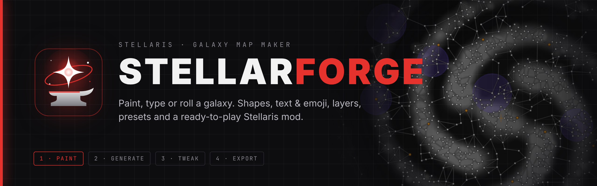
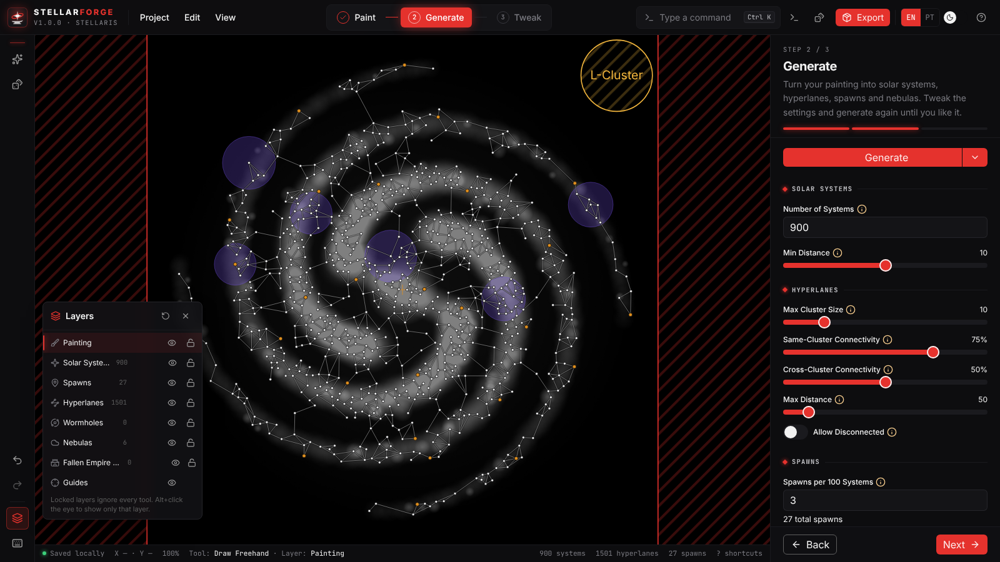
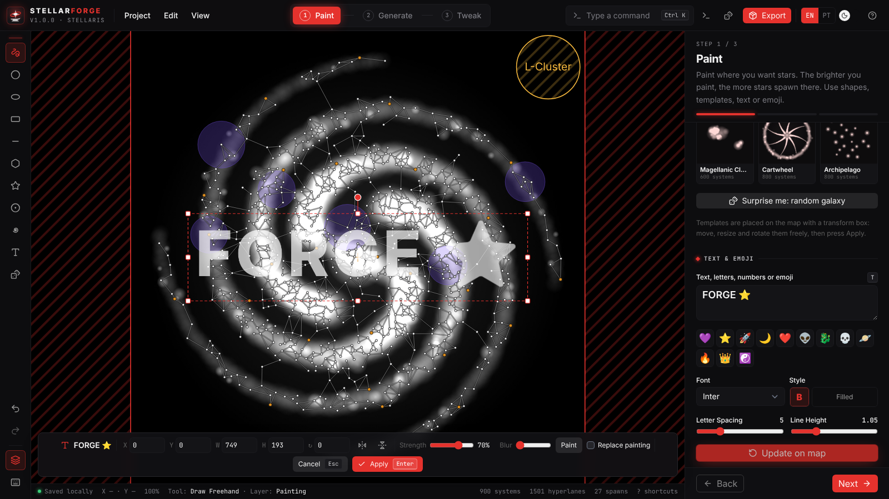
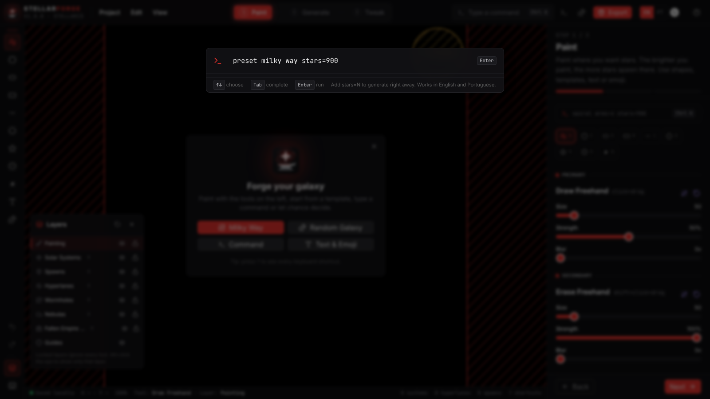
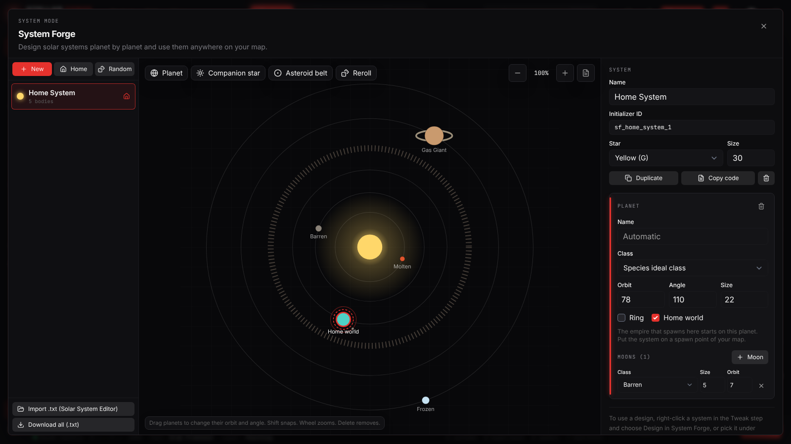
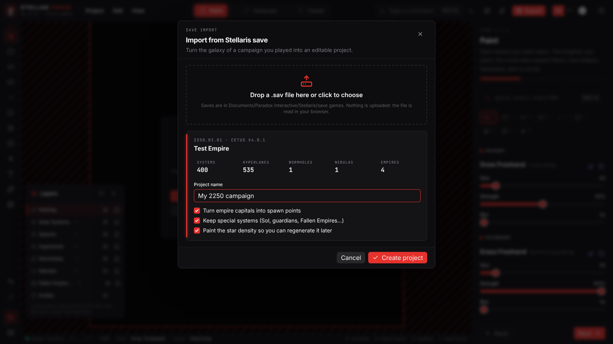
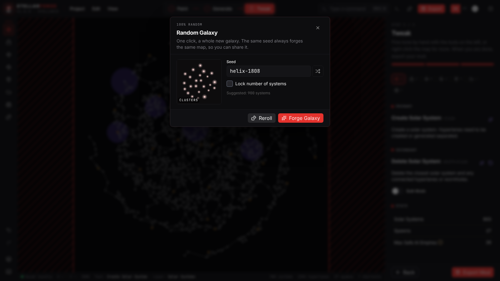
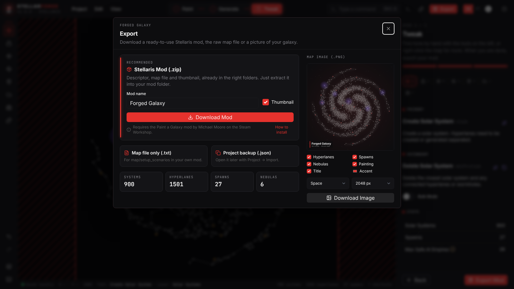

<p align="center">
  
</p>

<p align="center">
  <a href="https://agrichex.github.io/Stellar-Forge/"></a>
  <a href="https://discord.gg/s3EbgNSsJW"></a>
  <a href="https://steamcommunity.com/sharedfiles/filedetails/?id=3532904115"></a>
  
</p>

<p align="center">
  <b>English</b> · <a href="#-português">Português</a>
</p>

---

**Stellar Forge** is a galaxy map maker for **Stellaris** that runs in your browser. Paint where you want stars, type a shape, word or emoji, pick a famous galaxy or roll a fully random one. Then generate systems and hyperlanes, fine-tune them by hand and export a mod that is ready to play.

It is an improved fork of [Paint a Galaxy](https://github.com/oatmealproblem/paint-a-galaxy) by Michael Moore, with a new interface, keyboard-first controls, layers, typed generation and much more.

<p align="center">
  
</p>

## ✦ Features

|                                |                                                                                                                                                                                                                                                        |
| ------------------------------ | ------------------------------------------------------------------------------------------------------------------------------------------------------------------------------------------------------------------------------------------------------ |
| **🎨 Shapes**                  | Freehand, circle, ellipse, rectangle, line, polygon, star, ring and spiral, each with paint and erase versions.                                                                                                                                        |
| **⌨️ Typed galaxies**          | Type letters, numbers, words or emoji and they become a galaxy in that exact shape. Several fonts, bold, outline, spacing and line height.                                                                                                             |
| **🔲 Transform box**           | Everything you place (text, emoji or templates) can be moved, resized, rotated and flipped freely before you apply it. You can also type exact X, Y, W, H and angle.                                                                                   |
| **🗂️ Layers**                  | Painting, systems, spawns, hyperlanes, wormholes, nebulas, Fallen Empire zones and guides. Hide, lock, solo or fade any layer to edit only what you want.                                                                                              |
| **🌌 Templates**               | Milky Way, Andromeda, Whirlpool, Cartwheel and galaxies inspired by famous sci-fi universes (Star Wars, Star Trek, Warhammer 40k, Mass Effect, Halo, Dune...).                                                                                         |
| **🎲 100% random**             | One click forges a whole new galaxy from a seed. The same seed always gives the same map, so you can share it.                                                                                                                                         |
| **💻 Command bar**             | `Ctrl K` and type things like `spiral arms=3 twist=1.2 stars=800` or `text "HELLO" stars=600`. Works in English and Portuguese.                                                                                                                        |
| **📦 One-click mod**           | Download a zip with descriptor, map file and thumbnail already in the right folders. Set the mod name, version, description, tags and icon (your own image or a picture of the map). Also exports `.txt`, project `.json` and a StellarMaps-style PNG. |
| **🔁 Update your mod**         | Every exported mod carries the project inside. Use **Project → Open mod (.zip)** to bring it back, change the map and release the next version. Other galaxy mods are rebuilt from their map file.                                                     |
| **🧭 Simple by default**       | The editor shows only what you need. Turn on **View → Advanced mode** for every setting, the command field and extra status details.                                                                                                                   |
| **📚 Home, forum and credits** | A calm home page, a forum with guides and tutorials for every feature, and a credits page with links to the Discord and Agriche Nexus.                                                                                                                 |
| **🌐 EN / PT-BR**              | Full interface in English and Brazilian Portuguese.                                                                                                                                                                                                    |

## 🚀 Quick start

1. Open **[agrichex.github.io/Stellar-Forge](https://agrichex.github.io/Stellar-Forge/)**.
2. **Paint**: draw with the tools, place a template, type text or press the dice for a random galaxy.
3. **Generate**: turn the painting into solar systems, hyperlanes, spawns and nebulas.
4. **Tweak**: add, move, delete or lock systems and lanes by hand.
5. **Export**: press `Ctrl E` and download the mod.

<table>
  <tr>
    <td></td>
    <td></td>
  </tr>
  <tr>
    <td align="center"><sub>Text & emoji with a free transform box</sub></td>
    <td align="center"><sub>Command bar</sub></td>
  </tr>
  <tr>
    <td></td>
    <td></td>
  </tr>
  <tr>
    <td align="center"><sub>System Forge: design your own solar systems</sub></td>
    <td align="center"><sub>Import the galaxy of a save</sub></td>
  </tr>
  <tr>
    <td></td>
    <td></td>
  </tr>
  <tr>
    <td align="center"><sub>100% random galaxy</sub></td>
    <td align="center"><sub>Export: mod, map file and image</sub></td>
  </tr>
</table>

## 📥 Installing the map in Stellaris

1. Subscribe to **[Paint a Galaxy](https://steamcommunity.com/sharedfiles/filedetails/?id=3532904115)** on the Steam Workshop. Your map uses it as a base.
2. Extract the zip from Stellar Forge into your mod folder:
   - Windows: `Documents\Paradox Interactive\Stellaris\mod`
   - Linux: `~/.local/share/Paradox Interactive/Stellaris/mod`
   - macOS: `~/Documents/Paradox Interactive/Stellaris/mod`
3. In the Paradox launcher, enable **Paint a Galaxy** and your new mod, with your mod loading after it.
4. Start a new game and pick your galaxy in the galaxy shape list.

## ⌨️ Keyboard

| Keys                    | Action                                                                  |
| ----------------------- | ----------------------------------------------------------------------- |
| `Ctrl K` or `/`         | Command bar                                                             |
| `?`                     | All shortcuts                                                           |
| `B C E R L G K O Q`     | Freehand, circle, ellipse, rectangle, line, polygon, star, ring, spiral |
| `1` to `9`              | Pick a tool from the current step                                       |
| `[` `]`                 | Smaller or bigger brush                                                 |
| `X`                     | Swap primary and secondary tool                                         |
| `T`                     | Text and emoji                                                          |
| `W A S D` or arrows     | Move the camera                                                         |
| `Space` + drag          | Pan with the mouse                                                      |
| `+` `-` `0`             | Zoom in, zoom out, reset camera                                         |
| `Alt 1` `Alt 2` `Alt 3` | Paint, Generate, Tweak                                                  |
| `Alt L`                 | Layers panel                                                            |
| `Shift 1` to `Shift 8`  | Show or hide a layer                                                    |
| `Ctrl Z` `Ctrl Y`       | Undo, redo                                                              |
| `Ctrl G`                | Generate everything                                                     |
| `Ctrl E`                | Export                                                                  |
| `Enter` `Esc`           | Apply or cancel the transform box                                       |

## 💬 Commands

```text
spiral arms=4 twist=1.1 core=15% stars=900
barred arms=2 bar=0.4
elliptical radius=400 squash=0.6
ring radius=350 thickness=60
clusters count=7
preset milky way
random seed=nebula-4242
text "AGRICHE 💜" font=Orbitron
star points=6 radius=200 inner=0.4
polygon sides=8 x=-200 y=100 radius=120
clear
generate
```

`x` and `y` are measured from the center of the map. Percentages work (`core=15%`). Add `stars=N` to generate right away. Portuguese aliases work too: `espiral bracos=3 torcao=1.1 estrelas=600`.

## 🛠️ Development

Requires Node 24 and pnpm 11.

```bash
pnpm install
pnpm dev --open
pnpm build
pnpm check
```

The site is deployed to GitHub Pages by `.github/workflows/pages.yml` on every push to `main`.

## ❤️ Credits

- **Agriche**: owner and founder of Stellar Forge.
- **Claude**: co-creator.
- **Michael Moore** ([oatmealproblem](https://github.com/oatmealproblem)): creator of the original [Paint a Galaxy](https://github.com/oatmealproblem/paint-a-galaxy), MIT license.
- **KillyBlame**: creator of the [Stellaris Solar System Editor](https://github.com/KillyBlame/Stellaris_Solarsystem_Editor) (MIT), the inspiration for System Forge.
- [Twemoji](https://github.com/jdecked/twemoji) (CC-BY 4.0), [Lucide](https://lucide.dev), [Skeleton](https://www.skeleton.dev), [Google Fonts](https://fonts.google.com), [StellarMaps](https://github.com/MichaelMakesGames/stellarmaps).

Stellaris is a trademark of Paradox Interactive. Stellar Forge is a fan project and is not affiliated with or endorsed by Paradox Interactive. Franchise names in the templates are only used to describe the inspiration.

---

## 🇧🇷 Português

**Stellar Forge** é um criador de mapas de galáxia para **Stellaris** que roda no navegador. Pinte onde quer estrelas, digite uma forma, palavra ou emoji, escolha uma galáxia famosa ou sorteie uma totalmente aleatória. Depois gere sistemas e hiperpistas, ajuste à mão e exporte um mod pronto pra jogar.

É um fork melhorado do [Paint a Galaxy](https://github.com/oatmealproblem/paint-a-galaxy) de Michael Moore, com interface nova, controles pelo teclado, camadas, geração por texto e muito mais.

### ✦ Recursos

- **🎨 Formas**: mão livre, círculo, elipse, retângulo, linha, polígono, estrela, anel e espiral, todas com versão de pintar e apagar.
- **⌨️ Galáxias digitadas**: digite letras, números, palavras ou emoji e eles viram uma galáxia nesse formato. Várias fontes, negrito, contorno, espaçamento e altura da linha.
- **🔲 Caixa de transformação**: tudo que você coloca (texto, emoji ou modelos) pode ser movido, redimensionado, girado e espelhado livremente antes de aplicar. Também dá pra digitar X, Y, L, A e ângulo exatos.
- **🗂️ Camadas**: pintura, sistemas, spawns, hiperpistas, wormholes, nebulosas, zonas de Império Caído e guias. Esconda, trave, isole ou deixe transparente qualquer camada pra editar só o que quiser.
- **🌌 Modelos**: Via Láctea, Andrômeda, Rodamoinho, Roda de Carro e galáxias inspiradas em universos famosos da ficção (Star Wars, Star Trek, Warhammer 40k, Mass Effect, Halo, Duna...).
- **🎲 100% aleatória**: um clique forja uma galáxia nova a partir de uma semente. A mesma semente sempre gera o mesmo mapa, então dá pra compartilhar.
- **💻 Barra de comandos**: `Ctrl K` e digite coisas como `espiral bracos=3 torcao=1.2 estrelas=800` ou `texto "OLÁ" estrelas=600`.
- **🪐 System Forge**: monte sistemas solares planeta por planeta, com estrela, planetas, luas, anéis, cinturões de asteroides, estrelas companheiras e mundo natal. Arraste os planetas nas órbitas, sorteie sistemas aleatórios e use qualquer projeto em qualquer sistema do mapa. Importa arquivos `.txt` do Stellaris Solar System Editor.
- **💾 Importar de um save**: abra o `.sav` de uma campanha que você jogou e transforme a galáxia num projeto editável, com sistemas, hiperpistas, wormholes, nebulosas e as capitais dos impérios como spawns. Tudo é lido no seu navegador.
- **📦 Mod em um clique**: baixe um zip com descriptor, arquivo do mapa e miniatura já nas pastas certas. Defina nome, versão, descrição, tags e ícone do mod (sua própria imagem ou a imagem do mapa). Também exporta `.txt`, `.json` do projeto e PNG no estilo StellarMaps.
- **🔁 Atualize seu mod**: todo mod exportado leva o projeto dentro. Use **Projeto → Abrir mod (.zip)** pra trazer de volta, mudar o mapa e lançar a próxima versão. Outros mods de galáxia são refeitos a partir do arquivo do mapa.
- **🧭 Simples por padrão**: o editor mostra só o necessário. Ligue **Ver → Modo avançado** pra ver todas as configurações, o campo de comandos e mais detalhes na barra de status.
- **📚 Início, fórum e créditos**: uma página inicial tranquila, um fórum com guias e tutoriais de cada recurso e uma página de créditos com links pro Discord e pro Agriche Nexus.
- **🌐 EN / PT-BR**: interface completa em inglês e português.

### 🚀 Como usar

1. Abra **[agrichex.github.io/Stellar-Forge](https://agrichex.github.io/Stellar-Forge/)**.
2. **Pintar**: desenhe com as ferramentas, coloque um modelo, digite um texto ou clique no dado pra uma galáxia aleatória.
3. **Gerar**: transforme a pintura em sistemas solares, hiperpistas, spawns e nebulosas.
4. **Ajustar**: adicione, mova, apague ou trave sistemas e pistas à mão.
5. **Exportar**: aperte `Ctrl E` e baixe o mod.

### 📥 Instalando o mapa no Stellaris

1. Inscreva-se no **[Paint a Galaxy](https://steamcommunity.com/sharedfiles/filedetails/?id=3532904115)** na Oficina da Steam. Seu mapa usa ele como base.
2. Extraia o zip do Stellar Forge na pasta de mods:
   - Windows: `Documentos\Paradox Interactive\Stellaris\mod`
   - Linux: `~/.local/share/Paradox Interactive/Stellaris/mod`
   - macOS: `~/Documents/Paradox Interactive/Stellaris/mod`
3. No launcher da Paradox, ative o **Paint a Galaxy** e o seu mod novo, com o seu carregando depois.
4. Comece um jogo novo e escolha a sua galáxia na lista de formatos.

Aperte `?` dentro do app pra ver todos os atalhos de teclado.

### ❤️ Créditos

- **Agriche**: fundação e direção do Stellar Forge.
- **Claude**: co-criador.
- **Michael Moore** ([oatmealproblem](https://github.com/oatmealproblem)): criador do [Paint a Galaxy](https://github.com/oatmealproblem/paint-a-galaxy) original, licença MIT.
- **KillyBlame**: criador do [Stellaris Solar System Editor](https://github.com/KillyBlame/Stellaris_Solarsystem_Editor) (MIT), inspiração do System Forge.
- Twemoji (CC-BY 4.0), Lucide, Skeleton, Google Fonts e StellarMaps.

Stellaris é uma marca da Paradox Interactive. O Stellar Forge é um projeto de fã, sem vínculo com a Paradox Interactive.
